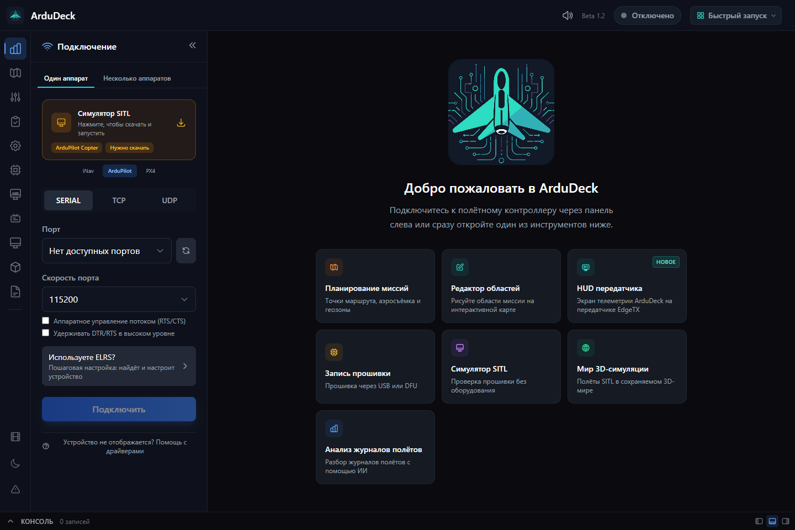
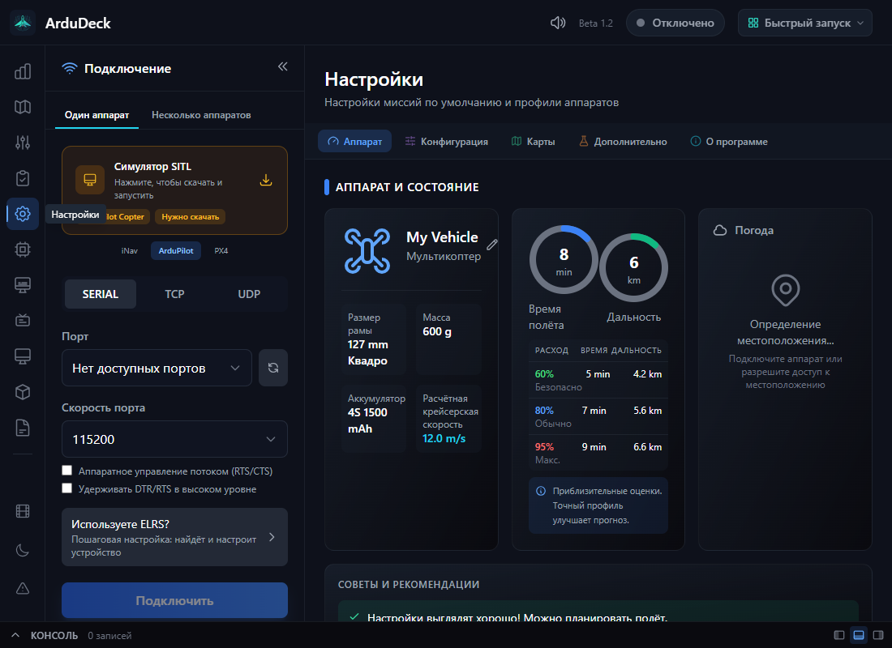

# Русская локализация ArduDeck

Неофициальный перевод интерфейса в форке [xaker-enginer/ardudeck](https://github.com/xaker-enginer/ardudeck).
Дата изменений: **27 октября 2026 года**.
Основа: коммит `16b471e6abe0042bcc40b5dd78d72dcc32b7289e` исходного проекта [ArduDeck](https://github.com/rubenCodeforges/ardudeck).

## Как включить

В приложении, собранном из этого форка, откройте **Settings → Language → Русский**.
При выборе системного языка русская локаль ОС (`ru`, `ru-RU` и другие варианты `ru`) также включает русский интерфейс.
Инструкции по запуску из исходников: [Building from Source](README.md#building-from-source).

Официальные установщики исходного проекта не содержат перевод этого форка.
Русский Windows-установщик публикуется в [релизах нашего форка](https://github.com/xaker-enginer/ardudeck/releases).
Установка, состав и сборка: [инструкция для Windows](docs/BUILD-WINDOWS-RU.md).
В версии `0.1.2-ru.1` русский язык выбран по умолчанию при первом запуске.

## Что переведено

Словарь: **56 файлов, 13 980 исходных ключей и 14 305 русских значений**,
включая дополнительные формы для **162 групп числительных**.

Все разделы английского словаря интерфейса в `apps/desktop/src/shared/i18n/locales/en/`
имеют русские соответствия в `locales/ru/`: подключение, телеметрия, настройки,
параметры, калибровки, миссии, аэросъёмка, карты, журналы, симуляция, Lua,
камеры, дополнительные модули, уведомления и подсказки. Добавлены русские формы
множественного числа. Удаление точки маршрута использует общий перевод подсказки.

Названия режимов полёта, параметров, протоколов, продуктов, единицы измерения
и сочетания клавиш сохранены. Например, `RTL`, `SERVO1_FUNCTION` и `m/s`
должны совпадать с документацией и данными контроллера.

Сообщения самой прошивки, загружаемые описания параметров, содержимое сторонних
модулей, низкоуровневая диагностика, пользовательские названия и тексты внешних сервисов могут оставаться
на исходном языке. Они не являются частью словаря приложения.

## Проверка и сопровождение

```sh
node tools/i18n/verify-locale.mjs ru
node tools/i18n/verify-ru.mjs
```

Первая команда запускает штатную проверку проекта. Вторая дополнительно проверяет
все русские формы `one`, `few`, `many`, `other`, точное сохранение подстановок,
тегов, ссылок и имён параметров. Запускайте обе проверки после изменения
английского или русского словаря. Автоматический запуск в GitHub Actions
для этого перевода пока не подключён.

После обновления исходного проекта новые строки нужно перевести. Для непереведённых
ключей приложение использует английский текст. Совпадения с английским требуют
ручной проверки: названия продуктов и технические обозначения переводить нельзя.

Терминология и правила текста: [глоссарий](tools/i18n/glossary-ru.md).
Автоматические проверки не заменяют проверку смысла предупреждений и просмотр
экранов, особенно длинных подписей и диалогов в небольшом окне.

### Результат проверки 27.10.2026

- Обе проверки словаря: **0 ошибок**, пропущенных английских ключей нет.
- Переключение языка и русские числительные: **12 тестов пройдено**.
- Полная сборка проекта: **15 сборочных задач успешно**.
- ESLint изменённых TypeScript-файлов: ошибок нет; в исходном `App.tsx`
  остаются два предупреждения о зависимостях `useEffect`.
- Собранный интерфейс проверен в окнах 1440×960 и 1100×800:
  старт, настройки, параметры и миссии; ошибок JavaScript нет.
  Lua-редактор дополнительно просмотрен в режиме разработки.
- Язык HTML-страницы следует выбранному языку интерфейса (`ru` для русского).

Первоначальная визуальная проверка проводилась с тестовым каналом Electron API, без контроллера,
при заблокированных внешних запросах. Карты, онлайн-сервисы и управление аппаратом
так не проверяются. На этом этапе готовый установщик и работа на оборудовании
не испытывались; результаты последующей Windows-сборки приведены в её релизе.

На этапе первого перевода общая проверка типов не проходила из-за прежней ошибки
`apps/desktop/src/main/index.ts:415`, `TS18048: app.dock is possibly undefined`.
Та же строка есть в исходном коммите `16b471e6`. При подготовке Windows-релиза
`0.1.2-ru.1` добавлена проверка наличия `app.dock`; общая проверка типов после
этого прошла. Это исправление относится к подготовке выпуска, а не к словарю.

### Снимки интерфейса





## Уточнения исходного текста

В английском и русском описаниях элеронов исправлены перепутанные направления
крена: левый элерон вниз создаёт крен вправо, правый вниз создаёт крен влево.
Формулировки согласованы с тестовым экраном приложения и разделом
[Confirm RC Transmitter Input в документации ArduPilot](https://ardupilot.org/plane/docs/guide-four-channel-plane.html#confirm-rc-transmitter-input).
Изменены только описания, без изменения управления сервоприводами.

Локализованы пропущенные подписи характеристик аппарата. Для «дальности»,
«водоизмещения» и отметки новой функции используются отдельные ключи,
чтобы не смешивать их с диапазоном значений, типом корпуса и кнопкой создания.
Ширины столбцов в таблице расчётной дальности скорректированы для длинных подписей.

Встроенная справка редактора Lua переведена с сохранением исходного содержания
и примеров кода. В ней есть унаследованные неточности: фиксированный лимит 50KB,
запрет TCP/UDP, один одновременно выполняемый скрипт и путь `/scripts/`.
Возможности зависят от прошивки и платы; актуальный основной каталог ArduPilot:
`APM/scripts`. Для практической настройки используйте
[официальную документацию Lua](https://ardupilot.org/copter/docs/common-lua-scripts.html).

## Лицензия и авторство

Исходный ArduDeck: **Ruben M / rubenCodeforges**. Русская локализация этого форка:
**xaker-enginer**, 2026. Перевод и изменения распространяются под **GPL-3.0**.
Файлы [LICENSE](LICENSE) и [MODULE-EXCEPTION.md](MODULE-EXCEPTION.md), а также
исходные сведения об авторстве сохранены без изменений.

Этот форк не является официальной русской сборкой и не заявляет об одобрении
со стороны автора ArduDeck. Публикация перевода здесь не означает принятия
[CLA](CLA.md) или отправки вклада в исходный проект.
